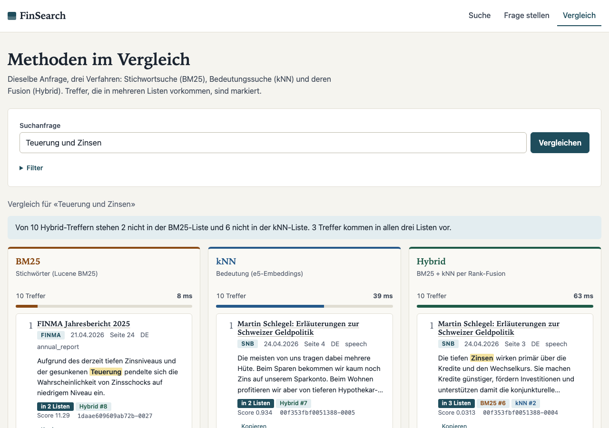
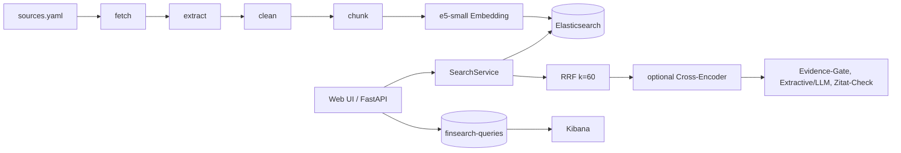

# FinSearch – Hybrid-Suche und RAG für Schweizer Finanzdokumente

FinSearch lädt öffentliche Finanzdokumente (SNB, US Federal Reserve, BIZ, FINMA, Zürcher Kantonalbank), zerlegt sie in Chunks und indexiert sie in Elasticsearch. Darüber liegen eine **Hybrid-Suche** (BM25 deutsch/englisch + Vektorsuche + Reciprocal Rank Fusion, optional Cross-Encoder) und eine **RAG-Schicht**, die Fragen ausschliesslich aus den gefundenen Quellen beantwortet, jede Aussage mit Quelle belegt und sonst «In den Quellen nicht gefunden» sagt. Läuft komplett lokal und ohne bezahlten API-Key.



## Architektur

Details: [docs/ARCHITECTURE.md](docs/ARCHITECTURE.md), Entscheide: [docs/DECISIONS.md](docs/DECISIONS.md), Interview-Fragen: [docs/INTERVIEW_NOTES.md](docs/INTERVIEW_NOTES.md).

## Quickstart
Voraussetzungen: Docker (≥ 8 GB RAM für Docker empfohlen), [uv](https://docs.astral.sh/uv/), Python 3.13.
```bash
make setup      # venv + Abhängigkeiten, kopiert .env.example nach .env
make up         # Elasticsearch, Kibana, API+UI, Kibana-Dashboard-Import
make ingest     # Download, Chunking, Embedding, Indexierung (~3 Min. auf CPU)
open http://127.0.0.1:8000      # UI   |   Kibana: http://127.0.0.1:5601
make test       # Unit-Tests (ohne ES)   |  make test-int (ES nötig)  |  make test-e2e (Browser)
make eval       # Evaluation -> reports/eval_results.md
make down
```
Optionale LLMs (Antwortqualität): in `.env` `LLM_PROVIDER=ollama|gemini|groq|anthropic` und ggf. den Key setzen. Standard ist `extractive` (wählt Sätze aus den Quellen, erzeugt keinen Text).

**Sicherheit:** Elasticsearch/Kibana laufen lokal ohne Security und nur an `127.0.0.1`. **Nicht für Produktion.**

## Evaluation (43 beantwortbare Fragen, 8 unbeantwortbare)
| Methode | Recall@5 | MRR | nDCG@10 | Latenz Median |
|---|---|---|---|---|
| BM25 | **0.826** | 0.685 | 0.729 | 11 ms |
| kNN (e5-small) | 0.651 | 0.536 | 0.572 | 15 ms |
| Hybrid (RRF) | 0.767 | 0.640 | 0.675 | 57 ms |
| Hybrid + Rerank (bge-reranker-base) | **0.860** | **0.743** | **0.779** | ca. 5 s (CPU) |

**Ehrlich: Hybrid ist hier nicht besser als BM25** (siehe ADR-008). Das Golden Set ist formulierungsnah an den Chunks und begünstigt BM25; bei Paraphrasen ist kNN besser. Konfidenzintervalle überlappen, 43 Fragen sind wenig. Voller Report mit Fehleranalyse und Experimenten: [reports/eval_results.md](reports/eval_results.md). Golden-Set-Herkunft: [eval/README.md](eval/README.md) (Fragen von Claude vorgeschlagen, jede gegen den Quelltext per wörtlichem Zitat geprüft).

**RAG-Gate** ([reports/rag_gate.md](reports/rag_gate.md)): 8/8 unbeantwortbare Fragen korrekt abgelehnt, 40/43 beantwortbare beantwortet (auf demselben Set getunt, optimistisch).

## Design-Entscheide (Kurzfassung)
RRF im Client statt ES-Retriever (testbar, lizenzunabhängig); `multilingual-e5-small` (384 d, CPU-tauglich); Index mit `german`/`english`-Feldern hinter Alias `finsearch`; `LLMClient`-Interface mit `extractive` als Standard; Zitate werden unabhängig vom Modell validiert (nicht existierende `[n]` fliegen raus). Siehe ADR-001 bis 008.

## Grenzen
- Kleines, selbst erstelltes Golden Set; Domänen-Bias; ein Embedding-Modell.
- Evidence-Gate ist lexikalisch und lehnt Paraphrasen/Cross-Language-Fragen teils fälschlich ab.
- Kein Lockfile-Zwang im Docker-Build, Reranker nicht auf Revision gepinnt, CI führt keine Integrationstests aus, Re-Index entfernt veraltete Chunks nicht (siehe [reports/review.md](reports/review.md) M4/M5/M8).
- Der erste Query nach Start lädt das Embedding-Modell (~10 s).
- **Lizenz der Quellen:** SNB/BIZ nicht-kommerziell mit Quellenangabe, Fed gemeinfrei; FINMA-Nutzungsbedingungen verlangen für Vervielfältigung schriftliche Zustimmung, bei ZKB fehlt eine explizite Lizenzaussage. Rohdokumente liegen nur lokal (`data/raw/`, nicht im Git). Quellen in `sources.yaml` vor einer öffentlichen Demo prüfen.

## Roadmap
Gewichtetes RRF und stärkeres Embedding-Modell testen; unabhängig formuliertes Golden Set; Evidence-Gate mit Reranker-Score; Chunk-Grössen-Experiment (300 vs. 500); Integrationstests in CI (ES-Service); Index-Versionierung mit Re-Index-Skript.
