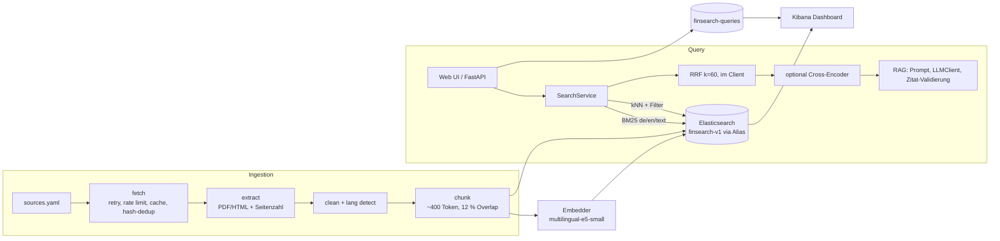

# Architektur

## Module und Schnittstellen
Alle Module sprechen nur über `src/finsearch/contracts.py` (Dataclasses `Chunk`, `SearchHit`, `RagAnswer`; Protokolle `Embedder`, `Searcher`, `Reranker`, `LLMClient`).

| Paket | Verantwortung |
|---|---|
| `ingest/` | Quellen laden, Text extrahieren, bereinigen, chunken → `Chunk`-Liste (JSONL in `data/processed/`) |
| `search/` | Index-Mapping, Bulk-Indexierung, BM25/kNN/Hybrid/Rerank, Filter |
| `rag/` | Prompt, Provider (`extractive`, `ollama`, `gemini`, `groq`, `anthropic`), Zitat-Validierung |
| `api/` + `web/` | FastAPI-Routen, Middleware (Query-Logging), Jinja-UI |
| `eval/` | Metriken, Runner, Report auf dem Golden Set |
| `observability/` | Kibana-Dashboard (NDJSON) und Import-Skript |

## Datenmodell im Index
`chunk_id` (keyword, = ES `_id`), `doc_id`, `source`, `doc_type`, `lang` (keyword), `date` (date), `page` (integer), `title`/`url` (text+keyword), `text` (standard), `text_de` (german), `text_en` (english), `embedding` (dense_vector 384, cosine, HNSW). Die Textfelder werden beim Indexieren aus demselben Chunk-Text befüllt; die Suche gewichtet die Sprachfelder je Boost.

## Datenfluss einer Hybrid-Anfrage
1. Query einbetten (`query: `-Präfix). 2. BM25-Top-50 und kNN-Top-50 nacheinander (zwei ES-Roundtrips) mit denselben Filtern. 3. RRF: `score(d) = Σ 1/(k + rank_m(d))`, `k=60`, Tie-Break: höherer Score, dann bester Einzelrang, dann `chunk_id`. 4. Optional Cross-Encoder auf Top-30 → Top-k. 5. Für `/ask`: Top-k-Chunks → Evidence-Gate (ADR-007) → Extractive oder LLM-Prompt → Zitate prüfen.

## Betrieb
`docker compose`: `elasticsearch`, `kibana`, `api` (inkl. UI), `kibana-setup` (Einmal-Job für den Dashboard-Import). Ports nur an `127.0.0.1`; Security ist **nur für lokale Entwicklung** deaktiviert.
