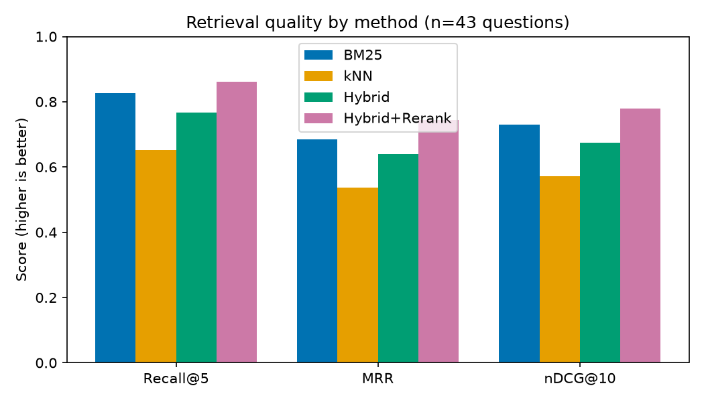
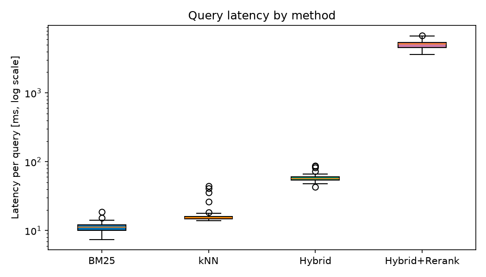

# FinSearch – Evaluation

- Datum: 2026-10-21
- Lauf: baseline_chunk400
- Golden Set: 51 Fragen, davon 43 beantwortbar (ausgewertet) und 8 unbeantwortbar (nur gezählt)
- Cutoff k: 10
- Index: by_lang={'en': {'chunks': 738, 'documents': 32}, 'de': {'chunks': 379, 'documents': 15}}, by_source={'bis': {'chunks': 321, 'documents': 9}, 'snb': {'chunks': 305, 'documents': 21}, 'finma': {'chunks': 225, 'documents': 4}, 'zkb': {'chunks': 165, 'documents': 3}, 'fed': {'chunks': 101, 'documents': 10}}, chunks=1117, documents=47

## Vergleich der Methoden

| Methode | Recall@1 | Recall@3 | Recall@5 | Recall@10 | MRR | nDCG@10 | Latenz Median (ms) | Latenz p95 (ms) |
|---|---|---|---|---|---|---|---|---|
| BM25 | 0.535 | 0.744 | 0.826 [0.709–0.930] | 0.860 | 0.685 [0.572–0.795] | 0.729 | 11.1 | 14.0 |
| kNN | 0.372 | 0.628 | 0.651 [0.512–0.779] | 0.733 | 0.536 [0.409–0.662] | 0.572 | 15.3 | 35.0 |
| Hybrid | 0.453 | 0.744 | 0.767 [0.628–0.884] | 0.814 | 0.640 [0.512–0.760] | 0.675 | 56.6 | 80.9 |
| Hybrid+Rerank | 0.605 | 0.826 | 0.860 [0.744–0.953] | 0.884 | 0.743 [0.627–0.850] | 0.779 | 5174.4 | 6520.4 |

Konfidenzintervalle: Bootstrap, 1000 Resamples, 95 %, fester Seed.

Mittlere Latenz je Stufe:
- BM25: bm25 11.3 ms
- kNN: embed 12.5 ms, knn 4.7 ms
- Hybrid: bm25 39.5 ms, embed 12.5 ms, fusion 0.1 ms, knn 6.8 ms
- Hybrid+Rerank: bm25 60.2 ms, embed 14.5 ms, fusion 0.3 ms, knn 8.8 ms, rerank 5015.4 ms

**Hybrid >= best single method on Recall@5 and MRR: no** – Recall@5: Hybrid 0.767 vs. BM25 0.826 (Konfidenzintervalle überlappen); MRR: Hybrid 0.640 vs. BM25 0.685 (Konfidenzintervalle überlappen)

## Aufschlüsselung (Recall@5 / MRR)

| Fragetyp | n | BM25 R@5 / MRR | kNN R@5 / MRR | Hybrid R@5 / MRR | Hybrid+Rerank R@5 / MRR |
|---|---|---|---|---|---|
| comparison | 4 | 1.00 / 0.88 | 1.00 / 1.00 | 1.00 / 1.00 | 1.00 / 1.00 |
| fact | 14 | 0.82 / 0.64 | 0.54 / 0.47 | 0.71 / 0.64 | 0.86 / 0.74 |
| number_date | 17 | 0.88 / 0.78 | 0.62 / 0.42 | 0.76 / 0.56 | 0.88 / 0.72 |
| paraphrase | 8 | 0.62 / 0.48 | 0.75 / 0.66 | 0.75 / 0.62 | 0.75 / 0.69 |

| Sprache | n | BM25 R@5 / MRR | kNN R@5 / MRR | Hybrid R@5 / MRR | Hybrid+Rerank R@5 / MRR |
|---|---|---|---|---|---|
| de | 17 | 0.82 / 0.60 | 0.65 / 0.60 | 0.65 / 0.57 | 0.82 / 0.69 |
| en | 26 | 0.83 / 0.74 | 0.65 / 0.50 | 0.85 / 0.69 | 0.88 / 0.78 |

## Fehleranalyse

### Fragen ohne relevanten Treffer in den Top 10

**BM25**: 6 von 43
- `q003` – Wie definiert die SNB Preisstabilität?
- `q022` – Gegenüber welchen Währungen verlor der US-Dollar während der Zollturbulenzen im Frühjahr …
- `q026` – Unter welchen Bedingungen gelingt eine Haushaltskonsolidierung laut BIZ eher?
- `q028` – How many on-site reviews did FINMA conduct at insurers in 2025?
- `q030` – Which self-assessments of larger insurers did FINMA review in 2025?
- `q036` – How much was the equity capital of Zürcher Kantonalbank at the end of 2025?

**kNN**: 11 von 43
- `q002` – By how many basis points did the SNB lift its policy rate within a year starting in mid-2…
- `q010` – How large is PostFinance's bank-specific Pillar 2 surcharge?
- `q012` – Wie haben sich die Zinsrisiken im Schweizer Bankensektor 2025 entwickelt?
- `q019` – What does Governor Barr expect for further monetary policy adjustments in his base case?
- `q022` – Gegenüber welchen Währungen verlor der US-Dollar während der Zollturbulenzen im Frühjahr …
- `q026` – Unter welchen Bedingungen gelingt eine Haushaltskonsolidierung laut BIZ eher?
- `q028` – How many on-site reviews did FINMA conduct at insurers in 2025?
- `q030` – Which self-assessments of larger insurers did FINMA review in 2025?
- `q035` – Wie hoch waren die Kundenvermögen der Zürcher Kantonalbank Ende 2025?
- `q036` – How much was the equity capital of Zürcher Kantonalbank at the end of 2025?
- `q043` – Welche Generalversammlung der SNB fand am 24. April 2026 statt?

**Hybrid**: 8 von 43
- `q003` – Wie definiert die SNB Preisstabilität?
- `q012` – Wie haben sich die Zinsrisiken im Schweizer Bankensektor 2025 entwickelt?
- `q022` – Gegenüber welchen Währungen verlor der US-Dollar während der Zollturbulenzen im Frühjahr …
- `q026` – Unter welchen Bedingungen gelingt eine Haushaltskonsolidierung laut BIZ eher?
- `q028` – How many on-site reviews did FINMA conduct at insurers in 2025?
- `q030` – Which self-assessments of larger insurers did FINMA review in 2025?
- `q035` – Wie hoch waren die Kundenvermögen der Zürcher Kantonalbank Ende 2025?
- `q036` – How much was the equity capital of Zürcher Kantonalbank at the end of 2025?

**Hybrid+Rerank**: 5 von 43
- `q022` – Gegenüber welchen Währungen verlor der US-Dollar während der Zollturbulenzen im Frühjahr …
- `q026` – Unter welchen Bedingungen gelingt eine Haushaltskonsolidierung laut BIZ eher?
- `q028` – How many on-site reviews did FINMA conduct at insurers in 2025?
- `q030` – Which self-assessments of larger insurers did FINMA review in 2025?
- `q036` – How much was the equity capital of Zürcher Kantonalbank at the end of 2025?

### Wo hilft oder schadet Hybrid?

**Hybrid besser als die beste Einzelmethode** (1):
- `q020`: Hybrid Rang 2, bester Einzelner (kNN) Rang 4 – Are small companies falling behind large ones in using artificial intelligence, according…

**Hybrid schlechter als die beste Einzelmethode** (11):
- `q002`: Hybrid Rang 6, bester Einzelner (BM25) Rang 1 – By how many basis points did the SNB lift its policy rate within a year starting in mid-2…
- `q003`: Hybrid Rang –, bester Einzelner (kNN) Rang 7 – Wie definiert die SNB Preisstabilität?
- `q007`: Hybrid Rang 2, bester Einzelner (BM25) Rang 1 – When is the SNB's Extended Liquidity Facility scheduled to go live?
- `q010`: Hybrid Rang 3, bester Einzelner (BM25) Rang 1 – How large is PostFinance's bank-specific Pillar 2 surcharge?
- `q012`: Hybrid Rang –, bester Einzelner (BM25) Rang 2 – Wie haben sich die Zinsrisiken im Schweizer Bankensektor 2025 entwickelt?
- `q013`: Hybrid Rang 2, bester Einzelner (BM25) Rang 1 – To what range did the FOMC raise its policy rate in September?
- `q019`: Hybrid Rang 3, bester Einzelner (BM25) Rang 1 – What does Governor Barr expect for further monetary policy adjustments in his base case?
- `q034`: Hybrid Rang 2, bester Einzelner (BM25) Rang 1 – Wie viel zahlt die Zürcher Kantonalbank dem Kanton als Abgeltung der Staatsgarantie?
- `q035`: Hybrid Rang –, bester Einzelner (BM25) Rang 1 – Wie hoch waren die Kundenvermögen der Zürcher Kantonalbank Ende 2025?
- `q039`: Hybrid Rang 2, bester Einzelner (kNN) Rang 1 – Wie glich die ZKB die Auswirkungen von Basel III Final auf die Rechnungslegung aus?
- `q043`: Hybrid Rang 6, bester Einzelner (BM25) Rang 4 – Welche Generalversammlung der SNB fand am 24. April 2026 statt?

## Experimente

| Variante | Methode | Recall@5 | MRR | nDCG@10 | Latenz Median (ms) |
|---|---|---|---|---|---|
| rrf_k=20 | Hybrid | 0.791 | 0.640 | 0.676 | 56.5 |
| rrf_k=60 (default) | Hybrid | 0.767 | 0.640 | 0.675 | 56.8 |
| rrf_k=100 | Hybrid | 0.767 | 0.639 | 0.675 | 59.2 |
| boost_text=0.0 | Hybrid | 0.767 | 0.640 | 0.675 | 57.9 |
| boost_text=1.0 | Hybrid | 0.767 | 0.639 | 0.677 | 55.9 |
| boost_de=1.5, boost_en=1.0 | Hybrid | 0.767 | 0.639 | 0.675 | 55.4 |
| boost_de=1.0, boost_en=1.5 | Hybrid | 0.767 | 0.632 | 0.668 | 55.9 |
| rerank off | Hybrid | 0.767 | 0.640 | 0.675 | 59.6 |
| rerank on | Hybrid+Rerank | 0.860 | 0.743 | 0.779 | 4209.5 |

## Ehrliche Einschränkungen

- **Kleines Golden Set**: 43 beantwortbare Fragen. Die Konfidenzintervalle sind breit; kleine Unterschiede zwischen Methoden sind statistisch nicht belastbar.
- **Domänen-Bias**: Das Korpus besteht aus wenigen öffentlichen Quellen (SNB, Fed, Schweizer Institute); Ergebnisse lassen sich nicht auf andere Domänen übertragen.
- **Ein Embedding-Modell**: Nur `multilingual-e5-small` wurde getestet; kNN- und Hybrid-Ergebnisse gelten nur für dieses Modell.
- **Herkunft der Fragen** (provenance): llm_suggested_verified: 51. Als `llm_suggested_verified` markierte Fragen wurden von einem LLM vorgeschlagen und anschließend von Hand gegen den Quelltext geprüft; sie können dennoch formulierungsnah an den Chunks liegen und BM25 begünstigen.
- **Relevanzurteile** sind binär und pro Frage nur für die markierten Chunks/Dokumente vollständig; weitere relevante Chunks gelten als nicht relevant (unterschätzt Recall/Precision).
- **Latenzen** stammen von einem einzelnen lokalen Lauf (ein Warm-up-Aufruf ausgeschlossen) und sind nur relativ zueinander aussagekräftig.
- Unbeantwortbare Fragen (8) fließen nicht in die Retrieval-Metriken ein.
